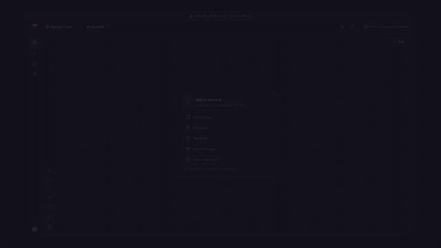

<p align="center">
  <picture>
    <source media="(prefers-color-scheme: dark)" srcset="site/public/logo-dark.svg">
    
  </picture>
</p>

# 5050cloud

Railway's developer experience on servers you own.

One command turns any Linux VM into a canvas of services with git deploys, databases, logs and rollbacks. Open source. No per-seat, per-minute or per-server fees.

<p align="center">
  <a href="https://5050cloud.com/#demo"></a>
  <br>
  <a href="https://5050cloud.com/#demo">Watch the 90 second demo</a> or <a href="https://github.com/musakkka/5050cloud/releases/download/v0.1.1/5050cloud-demo.mp4">download the MP4</a>.
</p>

```sh
curl -fsSL https://5050cloud.com/install.sh | sudo sh
```

Or with wget: `wget -qO- https://5050cloud.com/install.sh | sudo sh`. Piped, the installer asks nothing; run from a terminal, it offers a guided setup. Every answer is also a flag or a `FIFTY_*` environment variable. If the site is not reachable, the same script is at [`install/install.sh`](install/install.sh).

Docs: [5050cloud.com/docs](https://5050cloud.com/docs/quick-start/)

## Features

- **Canvas, environments and staged changes**: the Railway workflow, with a diff before every deploy.
- **Deploy anything**: GitHub repos (Railpack or Dockerfile), Docker images, or a directory with `5050 up`.
- **Databases in one click**: Postgres, MySQL, Redis and MongoDB, with Railway's variable names.
- **Variables with references**: `${{Postgres.DATABASE_URL}}` and `${{shared.KEY}}`, the same syntax as Railway.
- **Backups to any S3-compatible bucket**: point-in-time restore for Postgres, restore to a copy, promote.
- **Zero-downtime deploys** for services without a volume, health checks, and rollbacks that restore variables.
- **More hosts with one command**: agents dial out, so no inbound management port; replicas across hosts; private networking over WireGuard.
- **Use all cores**: run one process per vCPU, with Node cluster mode built in.
- **Custom domains with automatic HTTPS**, TCP proxies, logs with Railway's filter syntax, metrics for 30 days, monitors and alerts.
- **Move from Railway**: `5050 import railway`, `railway.json` honoured, and a `railway` CLI alias.
- **Self-reverting upgrades** and control plane state streamed to your bucket.

**Status: v0.1.0 is an early release.** A fresh single-host install was smoke tested end to end: sign-up, an image deploy, a generated HTTPS domain, and Postgres with a variable reference. Multi-host, backups, upgrades and the Railway import are built but have not yet been through the full release test suite on fresh VMs.

Read the [honest limits](https://5050cloud.com/docs/reference/honest-limits/) before you rely on it: one control host, databases on one host each, IPv4 only, Ubuntu 24.04 tested.

## CLI

```sh
curl -fsSL https://5050cloud.com/install.sh | sh -s -- --cli
5050 login https://console.example.com
5050 up --new
```

See the [CLI reference](https://5050cloud.com/docs/cli/overview/).

## Repository

| Path | What |
|---|---|
| `cmd/5050d`, `internal/cp` | Control plane and console API |
| `cmd/5050-agent`, `internal/agent` | Host agent: runtime, builds, networking, ingress |
| `cmd/5050`, `internal/cli` | The CLI |
| `web/` | The console |
| `pkg/` | API, agent protocol and manifest types |
| `templates/` | Database and app templates |
| `install/` | The installer and systemd units |
| `site/` | This project's website and docs |
| `e2e/`, `examples/` | End-to-end tests and sample apps |

Build from source: see [CONTRIBUTING.md](CONTRIBUTING.md).

## License

The server and console are [AGPL-3.0-only](LICENSE). The CLI, `pkg/`, `templates/`, `examples/`, `install/` and `site/` are MIT. See [LICENSING.md](LICENSING.md).

Security issues: see [SECURITY.md](SECURITY.md). 5050cloud is an independent project and is not affiliated with Railway.
